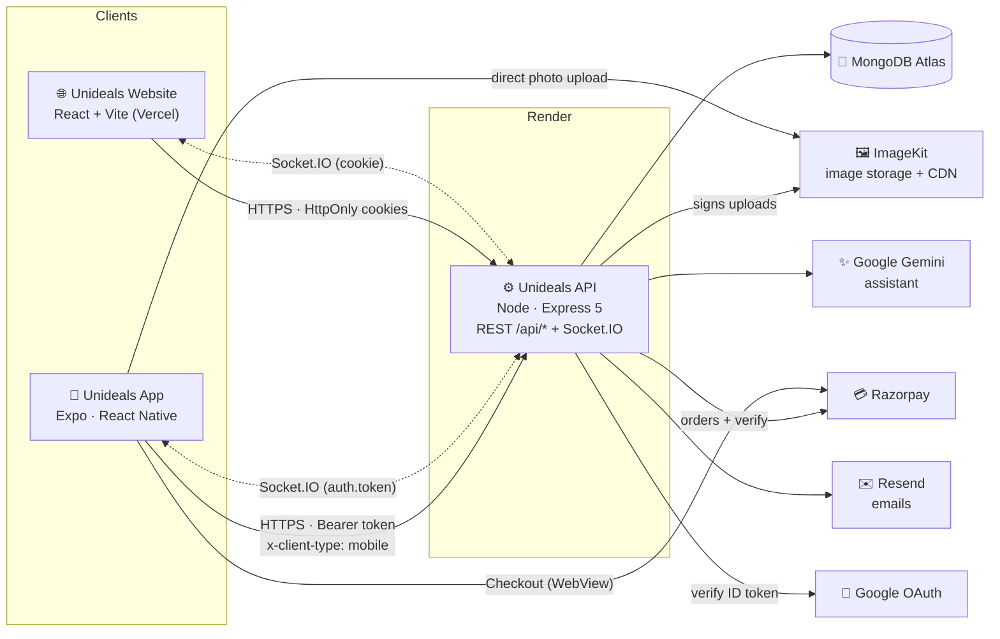
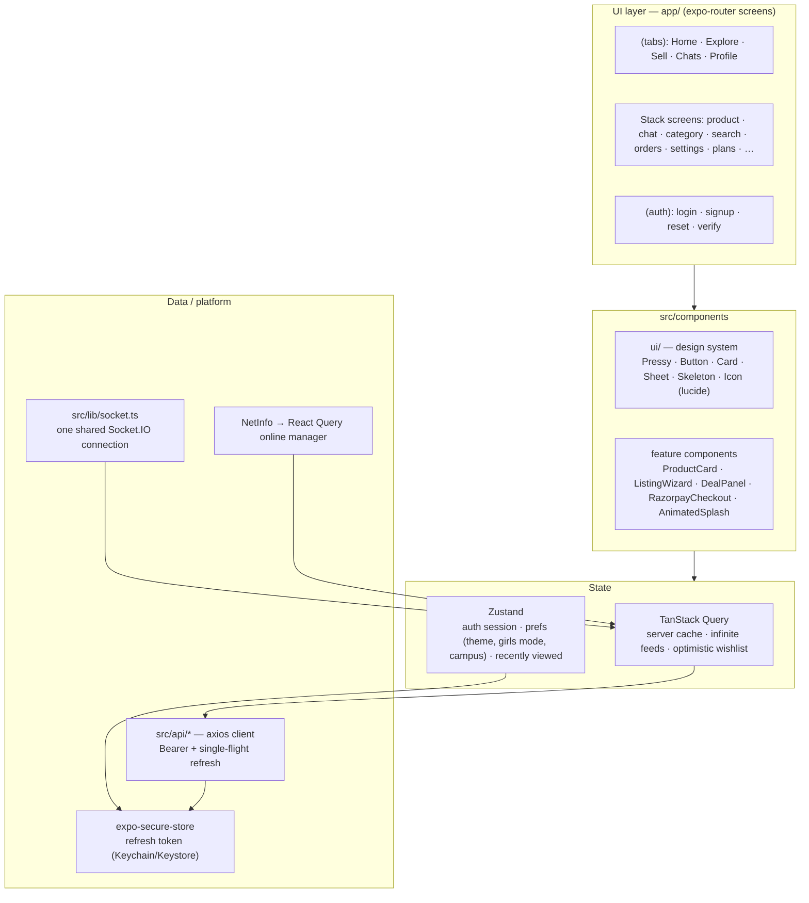
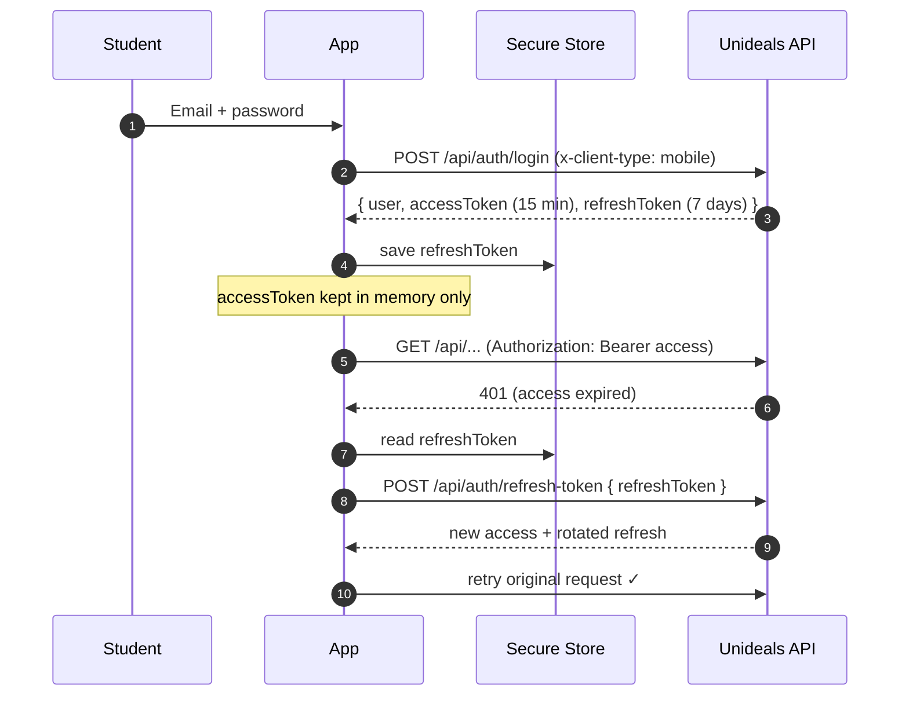
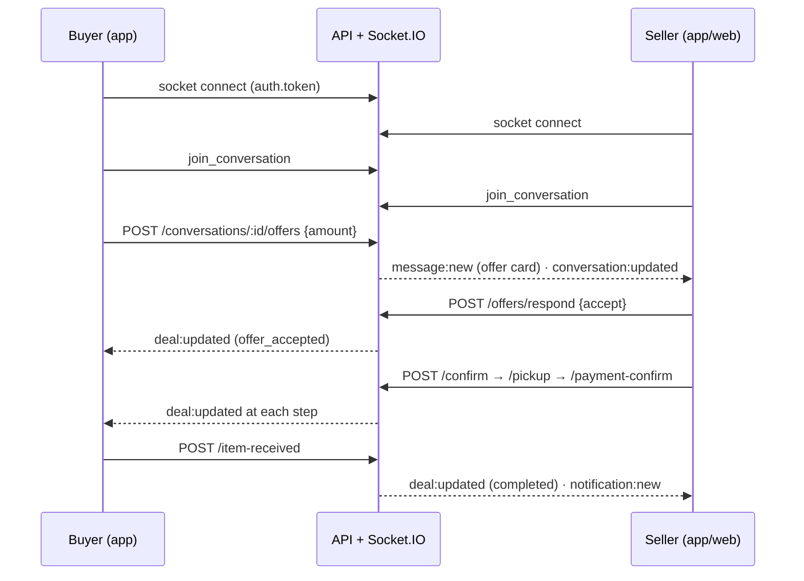
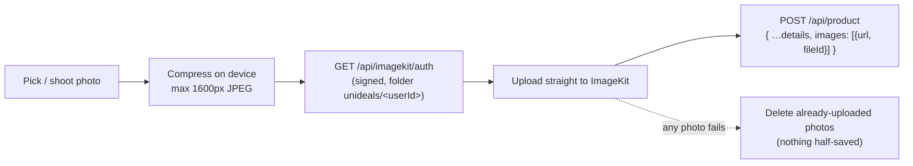

<p align="center">
  
</p>

<h1 align="center">Unideals App</h1>

<p align="center">
  The campus marketplace for students, as a native Android & iOS app.<br/>
  Same backend, same account, same listings and chats as <a href="https://app.unideals.in">app.unideals.in</a>.<br/>
  <sub>by <b>Imaginum</b></sub>
</p>

---

## Contents

- [What's inside](#whats-inside)
- [Architecture](#architecture)
  - [System overview](#system-overview)
  - [Inside the app](#inside-the-app)
  - [Authentication (mobile mode)](#authentication-mobile-mode)
  - [Realtime chat & deals](#realtime-chat--deals)
  - [Listing a product (photo upload)](#listing-a-product-photo-upload)
- [Tech stack](#tech-stack)
- [Project structure](#project-structure)
- [Run it locally](#run-it-locally)
- [Environment variables](#environment-variables)
- [Build an APK / store build](#build-an-apk--store-build)
- [Backend requirements](#backend-requirements)
- [Known limitations](#known-limitations)

---

## What's inside

| Area | Highlights |
| --- | --- |
| **Launch** | Animated brand intro (logo draws on, wordmark rises) · native splash in brand blue |
| **Home** | Personal greeting · quick picks (Under ₹500, New today…) · categories · limited-time deals · trending feed · recently viewed |
| **Browse** | Explore with filters & sort · search with suggestions, recent & trending · category pages · deals |
| **Product** | Instant open from the card · gallery + fullscreen viewer · specs · seller card · pickup & safety · share · report |
| **Sell** | 4-step flow: details (title→category suggestion, "write it for me") · photos (cover + 2) · price (insights, suggested price) · review with live card preview · drafts & autosave |
| **Chat** | Live messages, read ticks, typing, online · offers & counter-offers · deal tracker (confirm → pickup → payment → received) · quick replies · wallpapers · in-chat search · retry failed sends |
| **Account** | Profile overview (stats, to-dos, earnings, achievements) · my listings (boost / buy boost) · orders & ratings · wishlist · notifications · settings · pickup spots |
| **Money** | Pro / Pro Plus plans and ₹29/₹49 boosts via Razorpay · PDF receipts |
| **Extras** | AI assistant · Girls Corner 🌸 · dark mode · offline banner · haptics · FAQ & native Terms/Privacy |

---

## Architecture

### System overview

One backend serves both the website and the app. The app talks to it over HTTPS (REST) and a WebSocket (Socket.IO).



### Inside the app



**Design decisions**

- **One source of truth:** every screen reads server data through React Query, so the same listing, chat or order stays in sync everywhere; realtime events just invalidate or patch the cache.
- **Instant navigation:** tapping a product card hands its data to the product screen (`lib/productPreview.ts`), which paints immediately while the full record loads.
- **Website parity:** constants, validation rules, category art, FAQ, legal text and listing "smarts" are ported 1:1 from the website (`src/constants`, `src/content`), so both clients behave the same.

### Authentication (mobile mode)

The website uses HttpOnly cookies. Phones can't rely on cookie jars, so the backend has an opt-in **mobile mode**: requests carrying `x-client-type: mobile` **and no browser `Origin`** get tokens in the JSON body.



- Refreshes are **single-flight** (parallel 401s share one refresh).
- A network error during refresh never logs you out; only a real `401` from the refresh endpoint does.
- In mobile mode the server reads the refresh token **only from the body** and never sets cookies, so a website session can't be turned into JSON tokens.

### Realtime chat & deals



REST stays the source of truth; socket events update the screen instantly and refresh unread badges. On reconnect (app foregrounded, network back) the socket re-handshakes with a fresh token.

### Listing a product (photo upload)



---

## Tech stack

| Layer | Choice |
| --- | --- |
| Runtime | Expo SDK 58 · React Native 0.88 · React 19 · Hermes |
| Navigation | expo-router (file-based) · custom floating glass tab bar |
| Data | TanStack Query 5 · axios · socket.io-client |
| State | Zustand (persisted with AsyncStorage) |
| UI | Figtree font · lucide icons · react-native-svg · expo-image · expo-blur · expo-linear-gradient |
| Device | expo-secure-store · expo-image-picker/manipulator · expo-haptics · NetInfo · expo-print/sharing |
| Payments | Razorpay Standard Checkout in a WebView (works in Expo Go and store builds) |
| Language | TypeScript (strict) |

---

## Project structure

```
app/                         screens (file = route)
  _layout.tsx                providers · animated intro · guards · offline banner
  (tabs)/                    index (Home) · explore · sell · chats · profile + glass tab bar
  (auth)/                    login · signup · forgot / reset password · check / verify email
  product/[id]  chat/[id]  category/[slug]  edit-listing/[id]  legal/[doc]
  search  deals  campus  my-listings  wishlist  orders  notifications
  achievements  subscription  settings  pickup-spots  contact  faq  assistant
src/
  api/                       one module per backend area (auth, products, chat, payments, …)
  components/
    ui/                      design system: primitives, form, feedback, Icon, OfflineBanner
    brand/                   logo, wordmark, animated splash, "by Imaginum" footer
    home/ product/ chat/     feature components
    listing/ListingWizard    the 4-step Sell flow
    payments/                Razorpay checkout + purchase hook
    labs/ assistant/         price insights, early access, AI assistant button
  hooks/                     campus, wishlist, realtime, layout, Google sign-in
  store/                     auth session, prefs, recently viewed
  lib/                       env, tokens, socket, query client, haptics, toast
  constants/ content/        ported from the website (categories, FAQ, legal, listing smarts)
  theme/                     colour tokens (light / dark / girls mode), Figtree, shadows
assets/                      icon.png · adaptive-icon.png · favicon.png
```

---

## Run it locally

```bash
npm install
cp .env.sample .env            # fill in EXPO_PUBLIC_API_BASE_URL (+ ImageKit key)
npx expo start -c              # scan the QR with Expo Go
```

- On a phone, `localhost` is the phone itself: use your deployed API URL, or your PC's LAN IP (e.g. `http://192.168.1.20:5000`) with the backend running locally.
- If the Wi-Fi blocks phone↔PC traffic: `npx expo start -c --tunnel`.
- Checks: `npm run typecheck` · `npx expo-doctor`

## Environment variables

| Variable | Purpose |
| --- | --- |
| `EXPO_PUBLIC_API_BASE_URL` | Backend URL (same as the website's `VITE_API_BASE_URL`) — no trailing slash |
| `EXPO_PUBLIC_WEB_URL` | Website URL, used for share links |
| `EXPO_PUBLIC_IMAGEKIT_PUBLIC_KEY` | ImageKit **public** key (same as the website) |
| `EXPO_PUBLIC_DEFAULT_CAMPUS_SLUG` | Campus guests browse first (default `vit-vellore`) |
| `EXPO_PUBLIC_GOOGLE_*_CLIENT_ID` | Optional: Google sign-in (development/store build only) |

Everything prefixed `EXPO_PUBLIC_` is bundled into the app — never put secrets here.

## Build an APK / store build

```bash
npx eas-cli login
npx eas-cli build -p android --profile apk     # shareable APK
npx eas-cli build -p android --profile production
```

`.env` is not uploaded to EAS — build-time values live in the `env` block of the `apk` profile in `eas.json`. The signing keystore is managed by EAS (back it up with `npx eas-cli credentials`).

## Backend requirements

The app needs the **mobile auth mode** in `Unideals/backend/src/controllers/auth.controller.js` (covered by `npm run test:auth-mobile`). No new Render environment variables are required; optionally set `GOOGLE_MOBILE_CLIENT_IDS` for Google sign-in.

## Known limitations

- **Push notifications** arrive only while the app is open (the backend has no device-token endpoint yet).
- **Google sign-in** needs a development/store build plus mobile OAuth client IDs; hidden until configured.
- **One session per account:** signing in on the app ends the website session within ~15 min (backend stores a single refresh token).
- **Email links** (verify / reset password) open the website, which completes the flow.
- **Assistant photo questions** aren't supported (backend JSON limit is 10 KB).

---

<p align="center"><sub>Unideals · by <b>Imaginum</b> · Made with ❤️ for students</sub></p>
